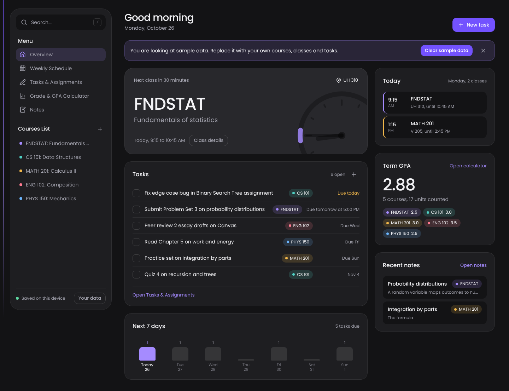

# College Hub

A student dashboard that puts your class schedule, deadlines, notes and grades in one place. Built for DLSU students first.

> Status: V1 is built. Next up is feedback from DLSU students, a PWA install and polish.



<!-- Add a demo GIF here:  -->

## Why this exists

Students juggle a timetable app, a to-do app, a notes app and a grade spreadsheet. College Hub connects them. The schedule drives the hero banner. Tasks drive Study Mode. Class sessions link to notes.

## V1 features

- [x] **Hero banner** that changes with the time of day. It shows the class in session with a progress bar, the next class with a countdown, or study mode with your most urgent tasks. A live clock face marks the stretch to the next class.
- [x] **Weekly schedule** with color-coded courses and recurring classes. Click an empty slot to add a class, pick several days at once, and get a warning when two classes overlap. A class detail drawer shows the room, professor, office hours, notes and open work.
- [x] **Assignments and to-dos** with an urgency engine (overdue, due today, this week, later), course filters, quick add and undo on delete.
- [x] **Canvas sync** by importing an iCal (.ics) file or pasted feed text. Course tags like `[FNDSTAT-A]` match your courses and re-importing skips what you already have.
- [x] **What-if grade calculator** with weighted components, the average you need on the rest, a what-if slider for each ungraded item, term GPA, cumulative GPA, a target planner and an editable grading scale.
- [x] **Notes** in markdown linked to class sessions. Take notes for the class in session straight from the hero banner.

Also in V1: search across courses, tasks, classes and notes (press `/`), sample data you can clear or restore, and everything saved in the browser.

## Tech stack

| Area | Choice | Why |
| --- | --- | --- |
| Framework | React 19 + TypeScript + Vite | Fast dev loop and strict types |
| Styling | Tailwind CSS v4 + Lucide icons | Clean modern UI without custom CSS sprawl |
| State | Zustand | Small API and easy persistence |
| Storage | Browser localStorage / IndexedDB | No backend needed and works offline |
| Canvas | iCal (.ics) parser | Works without university IT or OAuth |
| Tests | Vitest + Testing Library | Same config as Vite |
| Lint | Oxlint | Very fast |
| CI | GitHub Actions | Lint, test and build on every push |

More detail in [docs/decisions.md](docs/decisions.md).

## Getting started

```bash
git clone https://github.com/<your-username>/college-hub.git
cd college-hub
npm install
npm run dev
```

Open the local URL that Vite prints.

## Scripts

| Command | What it does |
| --- | --- |
| `npm run dev` | Start the dev server |
| `npm run build` | Type-check and build for production |
| `npm run preview` | Preview the production build |
| `npm run lint` | Run Oxlint |
| `npm test` | Run Vitest in watch mode |
| `npm run test:run` | Run tests once |
| `npm run check` | Lint + test + build (run before pushing) |

## Project structure

```
src/
  app/            App shell and layout
  components/ui/  Shared UI pieces (buttons, cards, modals)
  features/
    hero/         Hero banner and the time-state engine
    schedule/     Weekly grid and class detail drawer
    assignments/  Task tracker and .ics import
    grades/       Grade math and what-if simulator
    notes/        Notes hub
  store/          Zustand stores
  lib/            Pure helpers (time, storage)
  data/           Demo seed data
  types/          Shared TypeScript types
  test/           Test setup
docs/             Architecture notes, decisions and screenshots
```

## Roadmap

1. ~~Hero banner time-state engine with tests~~
2. ~~Weekly schedule grid~~
3. ~~Assignments tab and .ics import~~
4. ~~Grade calculator~~
5. ~~Notes~~
6. PWA install and polish
7. Deploy and gather feedback from DLSU students
8. Canvas URL sync through a small proxy, and walk time between buildings

## License

MIT
